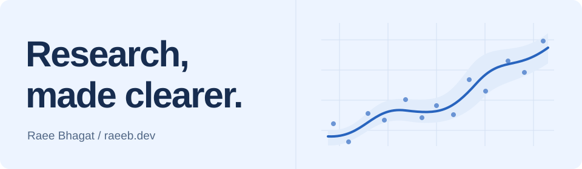

<a href="https://raeeb.dev/">
  <picture>
    <source media="(prefers-color-scheme: dark)" srcset="assets/banner-dark.svg">
    
  </picture>
</a>

# Hi, I’m Raee Bhagat.

**Biostatistician · Statistical modeling · Research data & tools**

I turn complex research data into statistical models, useful tools, and clear explanations. My work brings together biostatistics, data analysis, research data engineering, and data science—from making records reliable to explaining what an analysis can support.

Much of my recent work focuses on **aviation sleep, fatigue, and cognitive performance**. I work with longitudinal measurements, wearable data, survival and mixed-effects models, study simulations, and interactive R applications.

[**Explore my portfolio**](https://raeeb.dev/) · [View resume](https://raeeb.dev/Raee_Bhagat_Biostatistician_Resume_2026.pdf) · [LinkedIn](https://www.linkedin.com/in/raee-suresh-bhagat-53168890/) · [Email](mailto:raeesbhagat@gmail.com)

---

## A few projects to start with

### 01 · Understanding recovery over time

**When has cognitive performance returned to baseline—and what if recovery is never observed?**

This work connects endpoint definitions, repeated performance measurements, and sleep context to time-to-event analysis. The central decisions are how to define recovery, retain incomplete follow-up, and examine model assumptions.

`R` `survival` `dplyr` `lubridate` · Endpoint design, censoring, Cox models, diagnostics

[Read the case study](https://raeeb.dev/projects/recovery) · [Explore the documentation](https://github.com/raeesbhagat/pilot-recovery-survival-analysis)

### 02 · Building the dataset behind the analysis

**How do wearable exports, sleep logs, and flight records become comparable features?**

The workflow aligns participant and trip identifiers, resolves timestamp differences, and calculates flight-relative sleep windows. It makes the choices behind a feature visible, including the limits of estimating sleep across overlapping intervals.

`R` `dplyr` `purrr` `lubridate` `openxlsx` · Temporal joins, data preparation, feature engineering

[Read the case study](https://raeeb.dev/projects/sleep-data) · [Explore the documentation](https://github.com/raeesbhagat/actigraphy-sleep-feature-engineering)

### 03 · Making research explorable

**Can collaborators investigate cohort questions without losing sight of who is included?**

Interactive Shiny workflows connect filters to charts, tables, and cohort summaries. Participant, trip, and observation counts stay connected to the selected data so that an engaging interface also supports careful interpretation.

`Shiny` `Plotly` `DT` `ggplot2` · Reactive analytics, cohort exploration, visualization

[Read the case study](https://raeeb.dev/projects/dashboards) · [Explore the documentation](https://github.com/raeesbhagat/aviation-research-dashboards)

### 04 · Testing a study before collecting the data

**How sensitive is a proposed design to recruitment, repeated measurements, and missingness?**

Analytical sample-size calculations and Monte Carlo simulations explore design assumptions before a study begins. Related repeated-measures work examines participant variation and model behavior under simulated scenarios.

`TrialSize` `lme4` `R` · Power planning, non-inferiority, simulation, repeated measures

[Read the case study](https://raeeb.dev/projects/study-design) · [Power-planning documentation](https://github.com/raeesbhagat/study-power-sample-size-planning) · [Simulation documentation](https://github.com/raeesbhagat/repeated-measures-design-simulation)

**Keep exploring:** [All projects and connected workstreams](https://raeeb.dev/project-library) · [Methods and libraries](https://raeeb.dev/expertise)

> **About these repositories:** The featured repositories document methods and decisions from connected research workstreams; some involve shared or legacy workflows. They do not publish the original research implementation or participant data. Interactive examples on my portfolio use synthetic teaching data.

## How I approach the work

- **Start with the question.** Define the outcome, population, unit of analysis, and observation window.
- **Make the data dependable.** Resolve identifiers and timing, inspect missingness, and keep transformations traceable.
- **Choose and check the method.** Respect repeated observations, examine assumptions, and test sensitive choices.
- **Make the explanation useful.** Connect results to the question, with uncertainty and limitations in view.

## My working toolkit

**R is at the center of my research work.** These are some of the tools I use across the documented workflows:

| Area | Methods and tools |
| :--- | :--- |
| Statistical analysis | Survival analysis, mixed-effects models, repeated measures, simulation; `survival`, `lme4`, `lmerTest`, `effectsize` |
| Research data engineering | Temporal alignment, cohort construction, feature preparation; `dplyr`, `tidyr`, `purrr`, `lubridate`, `stringr` |
| Interactive analysis | Cohort exploration and scientific visualization; `Shiny`, `Plotly`, `DT`, `ggplot2` |
| Reproducible reporting | Research summaries and structured outputs; R Markdown, Quarto, `readxl`, `openxlsx` |

My broader background also includes **Python, SQL, SAS, Tableau, and Git/GitHub**. Earlier analytical work includes bacterial-growth modeling, particle MCMC, regression, and Bayesian networks. The detailed research case studies here focus primarily on R.

## What I’d like to explore next

I’m interested in applying these methods to public longitudinal health data, building tested analytics pipelines, and developing prediction projects with careful validation. These are [future project directions](https://raeeb.dev/expertise#directions), separate from the work documented above.

## Let’s connect

I enjoy working with people who care about the research question as much as the analysis. If your team needs thoughtful statistical work, reliable research data, or clearer analytical tools, I’d be glad to talk.

**[raeesbhagat@gmail.com](mailto:raeesbhagat@gmail.com)** · [LinkedIn](https://www.linkedin.com/in/raee-suresh-bhagat-53168890/) · [raeeb.dev](https://raeeb.dev/)
